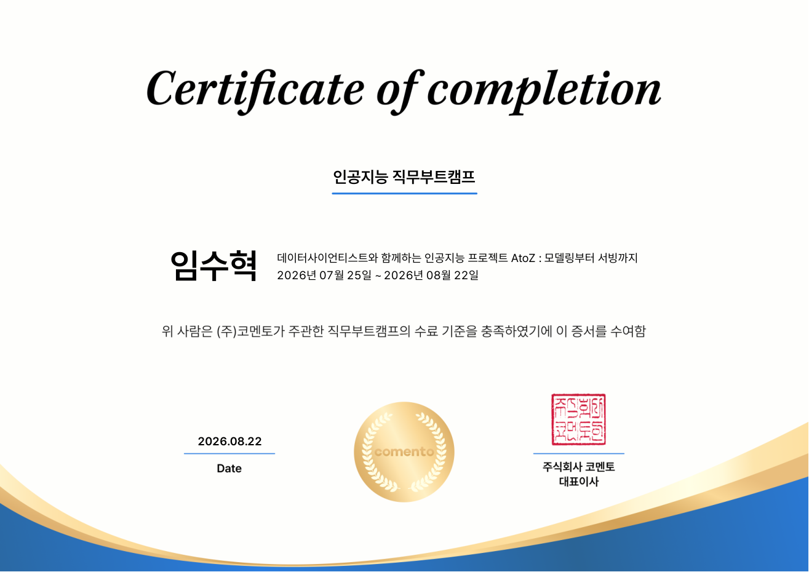

# data_ai_camp

코멘토 데이터 AI 부트캠프 실습 기록입니다. 자동차 객체탐지(YOLO) 프로젝트 코드와 주차별 학습 정리를 담고 있습니다.

## 수료증



## 구조

```
data_ai_camp/
├── code/
│   ├── 01_데이터셋_구축_코드.ipynb   # YOLO 학습용 데이터셋 구축
│   └── 02_yolo_모델_학습_코드.ipynb  # YOLO 모델 학습
├── notes/
│   ├── week1.md ~ week5.md          # 주차별 학습 정리
│   └── model_research.md            # 모델 선정 리서치 (YOLO26 선택 과정)
├── assets/
│   └── certificate.png              # 수료증 이미지 (README 표시용)
└── 4주차_전체과정_정리.pdf           # 최종 발표본
```

## 참고

- 데이터셋(이미지/라벨)과 모델 가중치 파일은 용량 문제로 저장소에 포함하지 않았습니다.
- 코드는 Google Colab 환경에서 실행하는 것을 기준으로 작성되었습니다 (구글 드라이브 마운트 등 Colab 전용 코드 포함).

